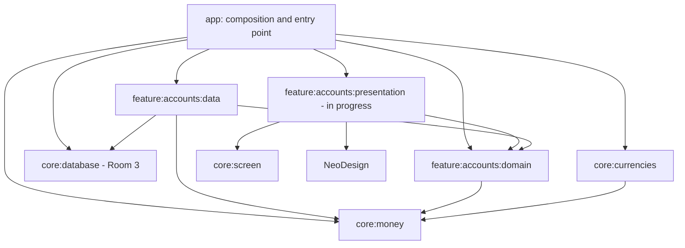

# Architecture overview

## Direction

Build a modular Android wallet application incrementally: verified foundations,
exact money handling, explicit currency policy, domain contracts, persistence,
composition, then real feature presentation.

The current implementation is Android-focused. Do not convert it to KMP solely
because Room 3 supports multiple platforms.

## Dependency map

Arrows mean "depends on". Presentation edges below are planned wiring.



NeoDesign's exact Gradle module path must be read from settings.gradle.kts;
its known package prefix is com.neodesign. Do not invent a module path.

## Runtime path

```text
Route -> ViewModel action handling -> domain repository interface
                                          |
                                          v
                                RoomAccountRepository
                                          |
                                          v
                                    AccountDao
                                          |
                                          v
                              WalletDatabase / SQLite

AccountDao Flow -> strict mapping -> ViewModel state -> route -> screen
```

## Ownership

- core:money: immutable money/currency values, parser, registry interface.
- core:currencies: explicit supported-currency subset and registry implementation.
- core:database: database construction, entities, DAOs, exported schemas.
- accounts domain: account values, validation, repository contract.
- accounts data: strict mapping and repository implementation.
- accounts presentation: screen contracts, ViewModel, route, feature screen.
- core:screen: shared ScreenState/ScreenAction/ScreenEvent/ScreenViewModel vocabulary.
- app: concrete graph composition and application entry point.
- NeoDesign: visual tokens/components; no wallet storage/domain dependency.

## Presentation pattern evidenced by the foundation

1. A ScreenState implementation describes renderable state.
2. ScreenAction describes user actions.
3. ScreenEvent describes transient events where needed.
4. ScreenViewModel exposes state and handles actions.
5. Route resolves the ViewModel and collects with lifecycle awareness.
6. Screen receives state/callbacks and uses NeoDesign tokens/components.

The shared base implementation has not been supplied in this conversation.
Inspect it before designing retry, collection lifetime, or event semantics.
Do not introduce a competing state architecture.

## Composition boundaries

- No DAO or Room entity in a screen or NeoDesign component.
- No Koin lookup inside a reusable visual component.
- No dependency from domain to Room/Koin/Compose.
- Accounts data receives CurrencyRegistry, not the concrete dataset module.
- The application container owns the production database singleton.
- Do not close the database at Activity/screen destruction.
- Do not add another global Koin startup.
